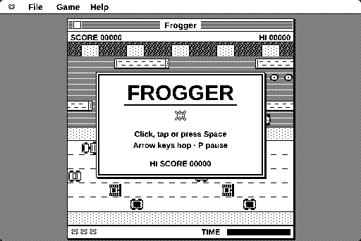
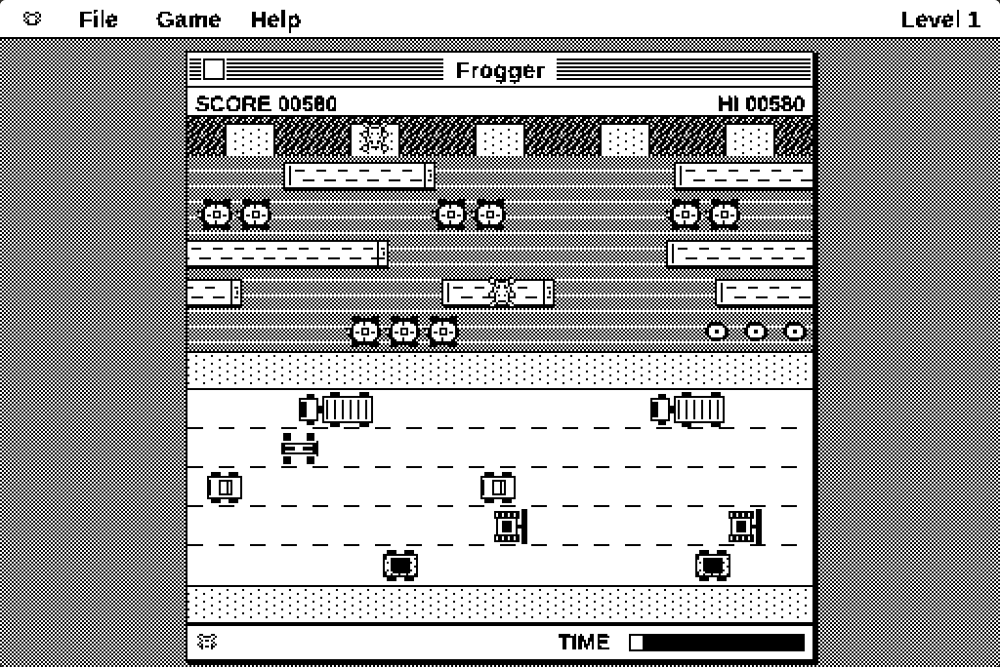
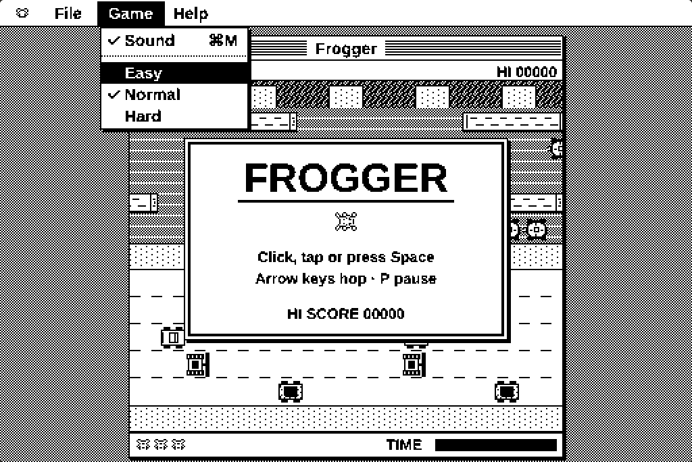
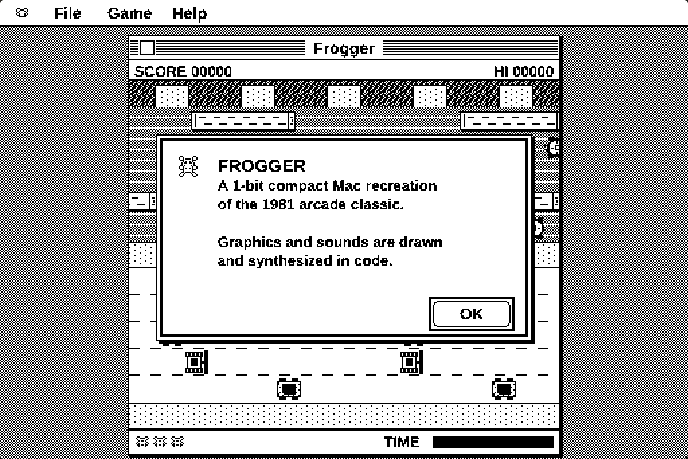

# Frogger (1-bit compact Mac recreation)

A fan recreation of the 1981 arcade classic **Frogger**, done the way it would have looked on a 1980s black-and-white compact Macintosh: 512×342 pixels, pure 1-bit graphics, a striped-title-bar window and a real pull-down menu bar. It's one self-contained HTML file with no downloads or installs.

All graphics and sounds are drawn and synthesized in code. No original game files, artwork or code are included. Frogger and its original design belong to Konami.

## ▶ [Play it in your browser](https://hardwaremack-prog.github.io/Frogger/)

## Screenshots

| | |
|---|---|
|  |  |
| **Title screen** | **Ride the logs and turtles home** |
|  |  |
| **Classic pull-down menus** | **About box** |

## How to play

Open `index.html` in Chrome, Edge, Firefox or Safari (desktop or phone).

- **Arrow keys / WASD** hop, **Space** or a click starts, **P** pauses, **M** toggles sound, **⌘/Ctrl+N** new game
- On a phone, **swipe** the screen or use the on-screen pad
- Cross five lanes of traffic, then ride logs and turtles across the river
- Fill all **5 bays** at the top to clear the level (+1000). Everything gets faster each level
- **Diving turtles** start sinking a second before they go under, then drop out from under you, and you drown if you ride off the edge of the screen
- Catch a **fly** in a bay for +200. Leftover time adds a bonus to every frog you bring home
- 30 seconds per frog, 3 frogs to start, extra frog every 10,000 points
- The **Game** menu has Sound and Easy / Normal / Hard

The high score is saved in your browser.
